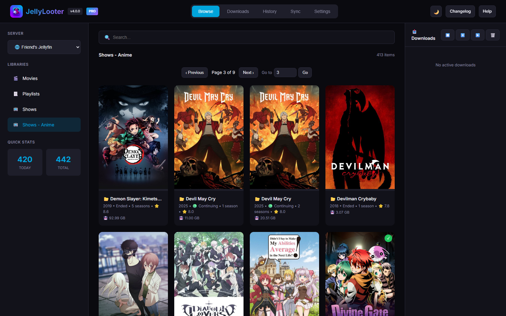
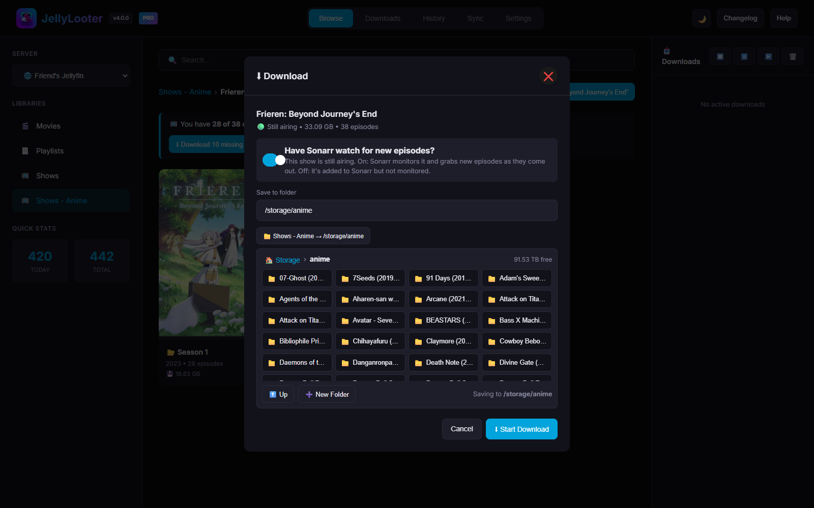
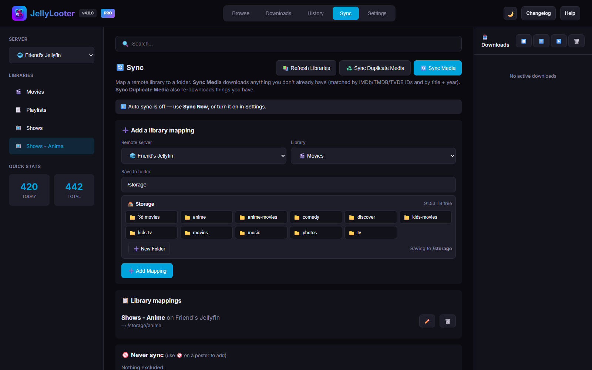
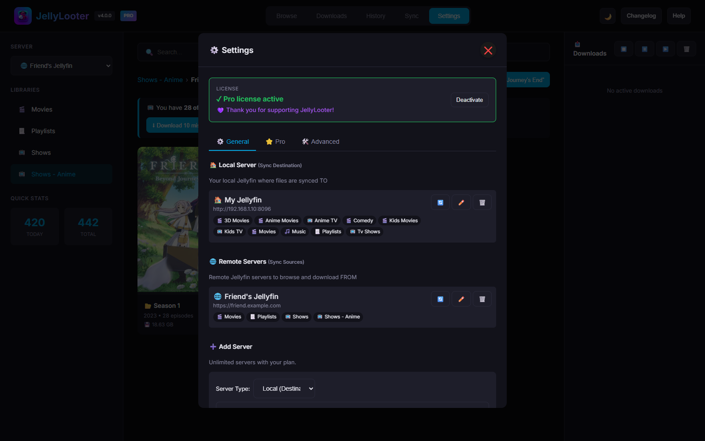
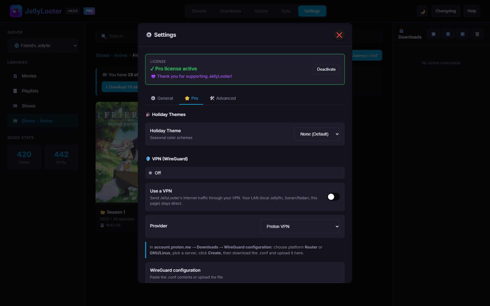
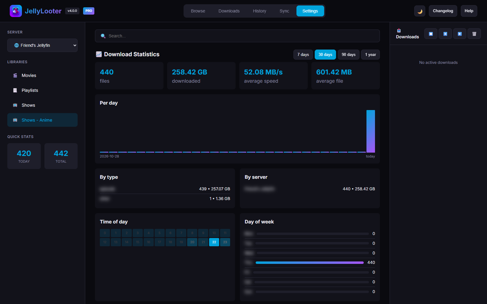
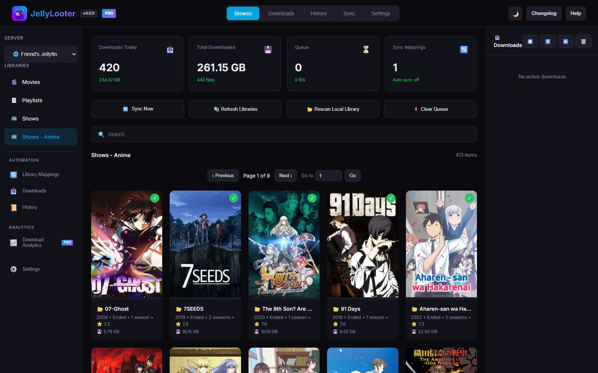
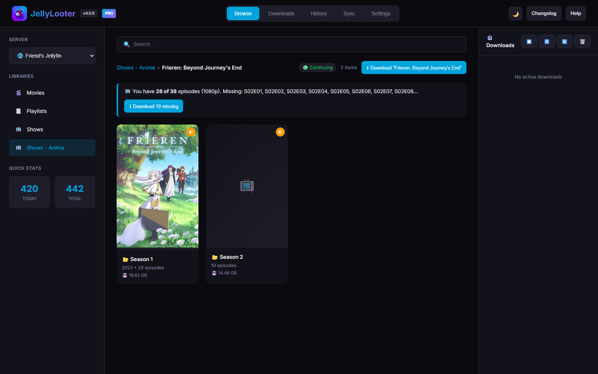
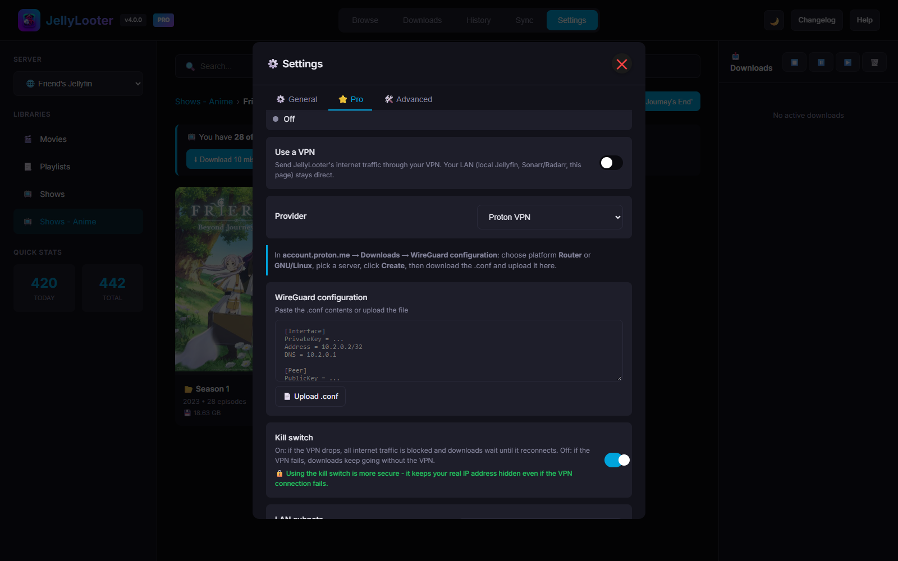

# JellyLooter v4.0.0

**Sync media from remote Jellyfin/Emby servers to your local storage.**

Built by Friendly Media — because your friends' Jellyfin libraries aren't going to backup themselves.


---

**Jump to:** [Installation](#installation) · [Free vs Pro](#free-vs-pro) · [GPU](#gpu-transcoding-pro) · [VPN](#built-in-vpn-pro) · [Sonarr/Radarr/Lidarr](#sonarr--radarr--lidarr-pro) · [Upgrading](#upgrading-from-v3x) · [API](#external-api)

---

## Screenshots

| Browse | Download | Sync |
|--------|----------|------|
|  |  |  |

| Settings | Pro & VPN | Statistics (Pro) |
|----------|-----------|------------------|
|  |  |  |

| Dashboard layout | Missing episodes | VPN & kill switch (Pro) |
|------------------|------------------|-------------------------|
|  |  |  |

---

## What's New in v4.0.0

A complete redesign, plus a much faster and more reliable download engine.

### 🖼️ Browsing
- New interface with two layouts: **Clean Grid** and **Dashboard**
- Posters show quality (4K / 1080p / HDR / Dolby Vision), rating and **size**
- **Green ✓ for anything you already have** — matched by IMDb, TMDB, TVDB, AniDB and other IDs *plus* title and year, so nothing is downloaded twice. Owned items hide the download button
- **Missing episodes** — owned shows display "−N" and offer "Download N missing" into your existing folder; sync fills them in too
- **Continuing / Ended** on every show; downloading a show that's still airing asks whether Sonarr should watch it for new episodes
- Real pages (Previous / Next / Page x of y / jump), 25–100 per page, 3–8 posters per row, and browser Back/Forward work
- Visual **folder picker** with breadcrumbs, subfolder tiles and "New Folder"
- Shows always go into `Season 01` folders; specials are offered separately and saved in `Specials`
- Your own local server is browse-only

### 🔄 Sync
- Map a remote library to a folder; **Sync Media** gets what you don't have, **Sync Duplicate Media** gets everything
- Never-sync list (🚫 on any poster)
- Adding a server automatically finds its libraries

### ⚙️ Settings
- **General / Pro / Advanced** tabs with your license status on top
- Every Test button (Jellyfin, TMDB, TVDB, OMDb, Sonarr, Radarr, Lidarr) shows the result on the button
- Advanced tab: live activity log, library rescan, login protection, external API key, timezone and performance, license backup, config export/import
- English, Spanish and German

### ⭐ New in Pro
- **Multi-connection downloads** — large files download in parallel parts (about 2× faster)
- **Crash-safe resume** — parts resume after an outage, files are size-checked and verified with ffprobe, and the queue comes back after a restart or power cut
- **Download when a server blocks downloads** — grabs the original-quality stream instead (same file, full speed)
- **Built-in WireGuard VPN** — Proton, PIA (built-in login + region picker), Mullvad, IVPN, AirVPN, Windscribe, Surfshark or any WireGuard config, with an optional **kill switch**
- **Sonarr / Radarr / Lidarr** get the show, movie or artist the moment you click Download (monitored, no indexer search), with automatic path detection
- **Detailed download statistics** — per day, type, server, hour and weekday, top titles, largest and fastest files (Download Analytics in the left sidebar)
- **Better quality available** — a blue ⬆ marks titles the remote has in higher resolution; "Download & replace" swaps them in after verifying each file

### 🚀 Fixes & improvements
- Downloads are dramatically faster (the license was being re-checked on every 64 KB chunk)
- Posters load through JellyLooter, so they work even when your browser can't reach the remote server
- **Upgrading from v3.x keeps every server, login, mapping and setting** (the old config is backed up)
- Server keys, VPN keys and passwords are never sent to the browser or included in exports

See the in-app **Changelog** for the full list.

---

## Free vs Pro

| Feature | Free | Pro ($10 lifetime) |
|---------|:----:|:-----:|
| Browse & download from remote servers | ✅ | ✅ |
| Local server duplicate detection (IDs + title/year) | ✅ | ✅ |
| Remote servers | 2 | Unlimited |
| Local servers | 1 | Unlimited |
| Sync mappings | 1 | Unlimited |
| Concurrent downloads | 2 | 10 |
| Season folders, specials, folder naming with IDs | ✅ | ✅ |
| Metadata keys (TMDB / TVDB / OMDb) | ✅ | ✅ |
| Basic statistics & history | ✅ | ✅ |
| Multi-connection downloads + crash-safe resume + verification | | ✅ |
| Download when a server blocks downloads | | ✅ |
| Built-in WireGuard VPN with kill switch | | ✅ |
| Sonarr / Radarr / Lidarr integration | | ✅ |
| GPU transcoding (NVIDIA / Intel / AMD) | | ✅ |
| Download & bandwidth scheduling, per-server downloads | | ✅ |
| Notifications (Discord, Telegram and 80+ services) | | ✅ |
| Missing-episode detection & download | ✅ | ✅ |
| Upgrade to better quality (download & replace) | | ✅ |
| Detailed statistics | | ✅ |
| Holiday themes, no banner | | ✅ |

**Get Pro:** [lightwave43.gumroad.com/l/rmtmrr](https://lightwave43.gumroad.com/l/rmtmrr)

---

## Compatibility

| Platform | Version | Status |
|----------|---------|--------|
| Unraid | 7.0+ | ✅ Tested |
| Docker | Linux / macOS / Windows | ✅ Supported |
| Jellyfin | 10.8+ | ✅ Supported |
| Emby | 4.7+ | ✅ Supported |

---

## Installation

JellyLooter runs as a Docker container. You need two folders:

| Container path | What it's for | Example |
|----------------|---------------|---------|
| `/config` | JellyLooter's settings | `/mnt/user/appdata/jellylooter` |
| `/storage` | Your media — downloads are saved inside it | `/mnt/user/data/media` |

The web interface runs on port **5000**.

### Option 1 — Unraid (Community Applications)

If JellyLooter is listed in Community Applications:

1. Open the **Apps** tab and search for **JellyLooter**
2. Click **Install**
3. Set **Storage Path** to your media share (for example `/mnt/user/data/media`) and **Timezone** to yours
4. Click **Apply**, then open the WebUI (`http://your-unraid-ip:5000`)

### Option 2 — Unraid (manual / template URL)

If JellyLooter isn't listed in Apps (yet), use the template URL:

1. **Docker** tab → **Add Container**
2. Next to **Template**, paste this URL and press Enter (or fill the fields in by hand):
   ```
   https://raw.githubusercontent.com/jlightner86/jellylooter/main/jellylooter.xml
   ```
3. If filling in by hand:

   | Field | Value |
   |-------|-------|
   | Name | `JellyLooter` |
   | Repository | `ghcr.io/jlightner86/jellylooter:latest` |
   | Network Type | `bridge` |
   | WebUI | `http://[IP]:[PORT:5000]` |
   | Port | `5000` → `5000` (TCP) |
   | Path `/config` | `/mnt/user/appdata/jellylooter` |
   | Path `/storage` | your media share, e.g. `/mnt/user/data/media` |
   | Variable `TZ` | your timezone, e.g. `America/Chicago` |

4. Optional **Extra Parameters** (Advanced View):
   - GPU transcoding on NVIDIA: `--runtime=nvidia` (see [GPU Transcoding](#gpu-transcoding-pro))
   - Built-in VPN: `--cap-add=NET_ADMIN` (see [Built-in VPN](#built-in-vpn-pro))
5. Click **Apply** and open `http://your-unraid-ip:5000`

### Option 3 — Docker (Linux)

```bash
docker run -d \
  --name jellylooter \
  --restart unless-stopped \
  -p 5000:5000 \
  -v /path/to/jellylooter/config:/config \
  -v /path/to/media:/storage \
  -e TZ=America/Chicago \
  ghcr.io/jlightner86/jellylooter:latest
```

Add `--runtime=nvidia -e NVIDIA_VISIBLE_DEVICES=all -e NVIDIA_DRIVER_CAPABILITIES=compute,video,utility` for an NVIDIA GPU, `--device /dev/dri:/dev/dri` for Intel/AMD, or `--cap-add=NET_ADMIN` for the built-in VPN.

### Option 4 — Docker Compose

Save as `docker-compose.yml`, change the media path, then run `docker compose up -d`:

```yaml
services:
  jellylooter:
    image: ghcr.io/jlightner86/jellylooter:latest
    container_name: jellylooter
    restart: unless-stopped
    ports:
      - "5000:5000"
    volumes:
      - ./config:/config
      - /path/to/media:/storage
    environment:
      - TZ=America/Chicago
    healthcheck:
      test: ["CMD", "python", "-c", "import urllib.request; urllib.request.urlopen('http://localhost:5000/health')"]
      interval: 30s
      timeout: 10s
      retries: 3
    # Optional - NVIDIA GPU (Pro):
    # runtime: nvidia
    # Optional - Intel/AMD GPU (Pro):
    # devices:
    #   - /dev/dri:/dev/dri
    # Optional - built-in VPN (Pro):
    # cap_add:
    #   - NET_ADMIN
```

The `docker-compose.yml` in this repository has the same options ready to uncomment.

### Option 5 — Docker Desktop (Windows / macOS)

Windows (PowerShell):

```powershell
docker run -d `
  --name jellylooter `
  --restart unless-stopped `
  -p 5000:5000 `
  -v C:\JellyLooter\config:/config `
  -v D:\Media:/storage `
  -e TZ=America/Chicago `
  ghcr.io/jlightner86/jellylooter:latest
```

macOS: use the Linux command with your own paths (e.g. `-v ~/JellyLooter/config:/config -v /Volumes/Media:/storage`).

Then open `http://localhost:5000`.

### Updating

- **Unraid:** Docker tab → **Check for Updates** → **Apply update** (or turn on auto-update)
- **Docker:** `docker pull ghcr.io/jlightner86/jellylooter:latest`, then remove and re-create the container with the same command
- **Compose:** `docker compose pull && docker compose up -d`

Your settings live in `/config`, so they're kept. Coming from v3.x? Everything carries over — see [Upgrading from v3.x](#upgrading-from-v3x).

### First run

1. Open **Settings → General** and add your **Local** server (your own Jellyfin) and one or more **Remote** servers (friends' Jellyfin/Emby). Each server's libraries are detected automatically.
2. Pick a remote server in the left sidebar, open a library and start browsing — a green ✓ marks things you already have.
3. Optional: map libraries on the **Sync** page so new media downloads automatically.

---

## GPU Transcoding (Pro)

The standard image already includes FFmpeg with NVIDIA NVENC, Intel QuickSync and AMD/Intel VAAPI support.

**NVIDIA (Unraid):**
1. Install the **Nvidia-Driver** plugin from Community Applications
2. Container → **Extra Parameters**: `--runtime=nvidia`
3. Add variables `NVIDIA_VISIBLE_DEVICES` = `all` and `NVIDIA_DRIVER_CAPABILITIES` = `compute,video,utility`
4. In JellyLooter: **Settings → Pro → Transcoding** → Encoder **NVIDIA NVENC**

**Intel QuickSync / AMD VAAPI:**
1. Add device `/dev/dri` (or Extra Parameters `--device=/dev/dri:/dev/dri`)
2. Choose **Intel QuickSync** or **AMD / Intel VAAPI** as the encoder

Docker Compose users can uncomment the GPU section in `docker-compose.yml`. If hardware encoding fails, JellyLooter falls back to software encoding automatically.

---

## Built-in VPN (Pro)

JellyLooter can send its internet traffic through WireGuard while your home network (local Jellyfin, Sonarr/Radarr, the web UI) stays direct.

1. Give the container network permission:
   - **Unraid:** Extra Parameters `--cap-add=NET_ADMIN`
   - **Compose:** `cap_add: [NET_ADMIN]`
2. **Settings → Pro → VPN**, pick your provider:
   - **Proton, Mullvad, IVPN, AirVPN, Windscribe, Surfshark** or any WireGuard provider: paste or upload the `.conf` from your provider (instructions shown in the app)
   - **PIA:** enter your username and password and pick a region
3. **Kill switch (recommended):** if the VPN drops, all internet traffic is blocked and downloads wait until it reconnects — your real IP stays hidden. With it off, downloads continue without the VPN.

---

## Sonarr / Radarr / Lidarr (Pro)

1. **Settings → Pro → *arr Integration**: enter each app's URL and API key (Settings → General → Security in the app), click **Test**
2. Click **Auto-detect** next to "How the *arr apps see /storage" (for example `/data/media`)
3. When you click Download, the show/movie/artist is added to the right app (monitored, no indexer search) and imported when the files finish

---

## Upgrading from v3.x

Just update the container. On first start, v4 moves your servers, logins, sync mappings and settings to the new layout automatically, and your Pro license carries over. A copy of the old settings is saved as `looter_config.json.v3-backup.json` in your config folder.

---

## External API

Control JellyLooter from NZB360, Organizr, Home Assistant and more. Create a key in **Settings → Advanced → External API**, then send it as `X-Api-Key`.

| Endpoint | Description |
|----------|-------------|
| `GET /api/v1/status` | Queue status, speeds, disk space |
| `GET /api/v1/queue` | Current download queue |
| `POST /api/v1/queue/add` | Add item to download queue |
| `DELETE /api/v1/queue/{id}` | Cancel/remove download |
| `POST /api/v1/queue/pause` | Pause all downloads |
| `POST /api/v1/queue/resume` | Resume downloads |
| `GET /api/v1/history` | Download history |
| `GET /api/v1/servers` | List configured servers |
| `GET /api/v1/servers/{id}/browse` | Browse server library |
| `GET /api/v1/servers/{id}/search` | Search server |
| `GET /api/v1/stats` | Download/transcode statistics |
| `GET /api/v1/docs` | Full documentation |

`GET /health` (no login) returns version, uptime, queue and disk status — HTTP 200 when healthy, 503 when not (e.g. disk under 1 GB free).

---

## Security

- Server tokens, *arr keys and VPN keys are encrypted on disk and never sent to the browser
- Optional login with bcrypt-hashed passwords, rate limiting and session timeout
- Path traversal protection on every file and folder operation
- If you expose JellyLooter outside your network, enable login (**Settings → Advanced**) and put it behind a reverse proxy

---

## Support

- **Buy Pro License:** [lightwave43.gumroad.com/l/rmtmrr](https://lightwave43.gumroad.com/l/rmtmrr)
- **Issues & Discussions:** [github.com/jlightner86/jellylooter](https://github.com/jlightner86/jellylooter/issues)
- In-app **Help** page covers every feature and common problems

---

## ⚠️ Legal Disclaimer

**JellyLooter is designed for legitimate personal use only.**

This software is intended to help users sync and backup media they have legal access to, such as:
- Content you own or have purchased
- Media shared by friends/family with their permission
- Content from servers you are authorized to access

**We do not support, condone, or encourage:**
- Piracy or illegal downloading of copyrighted content
- Circumventing DRM or copy protection
- Distributing copyrighted material without authorization
- Any use that violates copyright laws in your jurisdiction

**You are solely responsible** for ensuring your use of this software complies with all applicable laws and the terms of service of any media servers you access. The developers assume no liability for misuse of this software.

By using JellyLooter, you agree to use it only for lawful purposes.

---

## License

MIT License - Free to use, modify, and distribute.

Pro features require a valid license key.

---

## 🙏 Special Thanks

A huge thank you to our beta testers and contributors:

- **[vwidmer](https://github.com/vwidmer)** - Beta testing, bug reports, and feature suggestions for transcoding, *arr integration, and download improvements
- **[nwithan8](https://github.com/nwithan8)** - Fixed jellylooter.xml for Unraid Community Apps compatibility
- **[Z3r0Fell (ZeroFell)](https://github.com/Z3r0Fell)** - Testing, feedback, and feature suggestions for the v4.0 GUI overhaul

Want to contribute? [Open an issue](https://github.com/jlightner86/jellylooter/issues) or submit a pull request!
